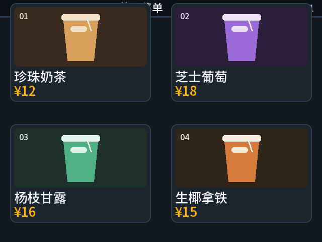
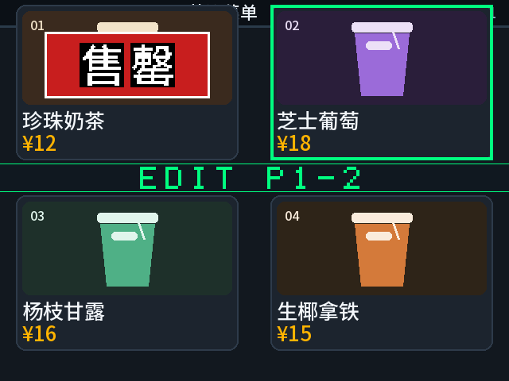
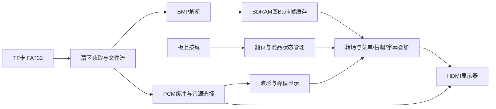

# MenuFlow · 动态售罄菜单显示终端

**一块 FPGA、一张 TF 卡、一台 HDMI 显示器，让电子菜单同时展示商品、售罄状态和有声促销。**

MenuFlow 面向餐饮门店的菜单与促销屏场景。传统静态菜单图片难以及时反映售罄，重新制作整张图片又会打断展示。本作品将菜单背景与商品状态分开：图片从 TF 卡读取，店员通过板上按键管理商品，FPGA 实时叠加中文售罄标记和选中框，同时保持翻页、转场、字幕及促销音频播放。

## 效果展示

| 菜单展示 | 商品售罄与管理 |
|---|---|
|  |  |

上图为软件生成的效果预览，实机显示以板卡输出为准。[更多菜单与促销预览](docs/演示图片.md) · [报告内嵌图片](docs/images/report-media/)

## 已实现功能

| 模块 | 功能 |
|---|---|
| 商品管理 | 两页菜单、每页四个商品，8项独立在售/售罄标记，中文售罄牌、选中框与管理模式提示 |
| 菜单与促销 | 四页图片、手动前后翻页、12秒自动轮播；促销页受商品编辑保护 |
| 视频显示 | 640×480 HDMI A 输出、四 Bank SDRAM 帧缓存、淡入淡出与 Wipe 转场、OSD状态和滚动字幕 |
| 促销音频 | TF卡裸PCM流式播放、HDMI音频、实时64点时域波形与峰值条，缺少PCM时回落内部音源 |
| 上电运行 | 支持配置Flash固化与上电启动；售罄标记保存在运行时寄存器，复位/掉电后恢复默认在售 |

本参赛版本使用固定640×480素材；图片缩放、亮度/对比度调节和缩略图交互尚未纳入本版本。音频格式为48 kHz、16位、小端、单声道裸PCM，不含WAV/MP3解码器。

## 硬件平台与工作原理

| 项目 | 配置 |
|---|---|
| 开发板 / FPGA | HX4S20/HX42S20，安路 EG4S20BG256 |
| 工具 / 顶层 | TD 6.2.168116 / `hx4s20_board_top` |
| 显示 / 存储 | HDMI A，640×480、约59.52 Hz；TF卡FAT32；板载SDRAM |
| 交互 | KEY1复位、KEY2/KEY3操作、KEY4切换管理模式 |



显示内容由背景图片和硬件图层组成，更新售罄状态时无需重写BMP。菜单管理在像素域维护商品状态，TF文件读取、帧缓存和音频缓冲按各自接口协同运行。详见 [系统结构图](技术报告/figures/fig02_system_block.png) 与 [技术报告](技术报告/MenuFlow动态售罄菜单显示终端_技术报告.docx)。

## 如何操作

| 按键 | 正常显示模式 | 商品管理模式 |
|---|---|---|
| KEY1 | 复位 | 复位并清除售罄标记 |
| KEY2 | 下一页 | 循环选择商品 |
| KEY3 | 短按开/关轮播，长按约1秒上一页 | 短按切换选中商品售罄/在售 |
| KEY4 | 进入商品管理 | 退出商品管理 |

进入管理模式后暂停轮播；只有第1/2页的菜单商品可编辑，第3/4页为促销页。按键时序和素材规格见 [使用说明](docs/使用说明.md)。

## 快速运行

1. 克隆仓库，在根目录执行 `python HX4S20_HDMI/tools/submission/prepare_project.py`，将TD工程路径设置到本机目录。
2. 准备FAT32 TF卡，将 `HX4S20_HDMI/assets/menu/` 的 `PIC1.BMP`～`PIC4.BMP` 全部复制到卡根目录。按需复制 `HX4S20_HDMI/assets/tf_audio/promo/` 的 `PIC3.PCM`、`PIC4.PCM`，启用中文促销语音。
3. 将TF卡插入开发板，连接HDMI A与显示器。按 [下载与验证](docs/下载与验证.md) 核对位流和板卡后，通过TD Programmer下载；也可按 [构建说明](docs/使用说明.md) 从源码重新构建。
4. 复位后查看菜单，使用KEY2/KEY3翻页或轮播，使用KEY4进入商品管理。

本仓库附带现有main基线的位流和对应报告。整理期间未重新构建或实板测试，详细构建证据及验证边界见 [构建证据](docs/validation/构建证据.md)。

## 目录与交付文件

```text
MenuFlow/
├── README.md                 作品介绍与快速运行
├── HX4S20_HDMI/              完整TD工程、RTL/IP/约束、运行素材和测试
│   └── HX4S20_HDMI_Config_Runs/phy_1/  唯一位流及对应时序/引脚报告
├── 技术报告/                 DOCX技术报告及架构插图
├── docs/                     使用说明、演示图、报告内嵌图与交付清单
└── 实验位流/manifest.json    本次交付位流的路径与SHA-256
```

## 快速入口

| 内容 | 入口 |
|---|---|
| 完整 TD 工程 | [HX4S20_HDMI_Config.al](HX4S20_HDMI/HX4S20_HDMI_Config.al) |
| 操作、TF 卡与编译 | [使用说明](docs/使用说明.md) |
| 可下载位流与校验 | [下载与验证](docs/下载与验证.md) |
| 技术报告 | [MenuFlow 技术报告.docx](技术报告/MenuFlow动态售罄菜单显示终端_技术报告.docx) |
| 更多效果预览 | [演示图片](docs/演示图片.md) |
| 交付文件校验清单 | [submission_manifest.json](docs/submission_manifest.json) |

本仓库保存本次参赛版本的独立快照。加密 HDMI/SDRAM IP 保持原内容；仓库当前未附加统一开源许可证。
