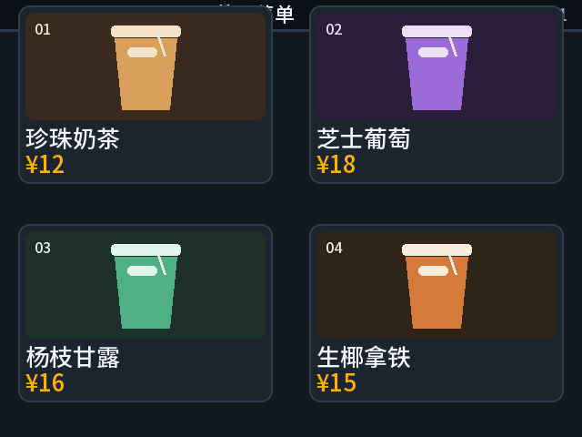
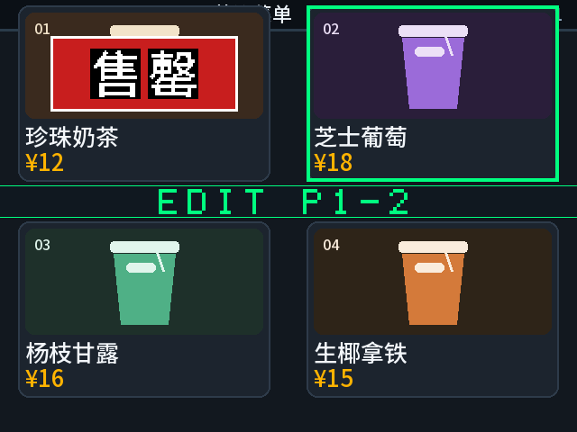
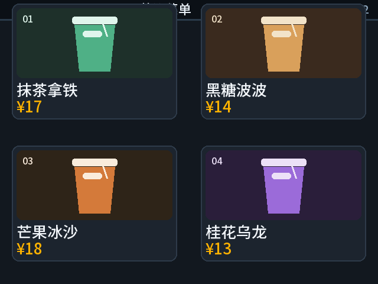
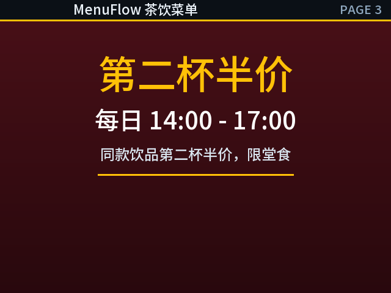
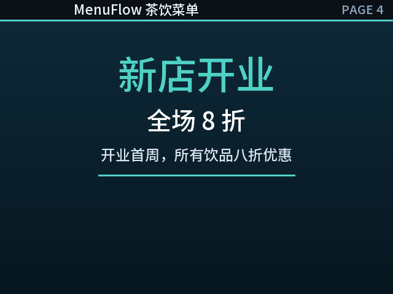

# 演示图片

以下为素材生成的菜单和售罄图层效果预览，不是本次拍摄的实机照片。

| 页面 | 预览 |
|---|---|
| 菜单第一页 |  |
| 商品售罄与编辑框 |  |
| 菜单第二页 |  |
| 促销第三页 |  |
| 促销第四页 |  |

系统图见 [系统结构图](../技术报告/figures/fig02_system_block.png)、[视频流水线](../技术报告/figures/fig03_pixel_pipeline.png) 和 [音频通路](../技术报告/figures/fig05_audio_path.png)。这些图是技术报告插图，供理解系统架构。

当前已保存DOCX中的 [报告内嵌图片](images/report-media/) 已按原字节提取，供查阅。它们的拍摄/生成时间和证据口径以技术报告为准，未归类为本次新增实测照片。
